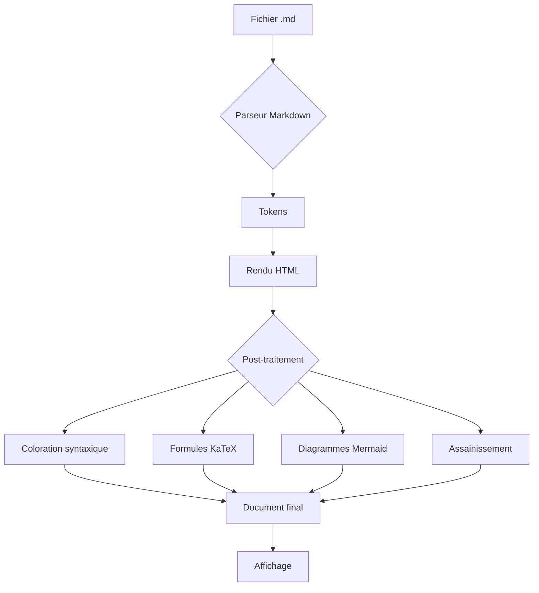

# Document de démonstration complète

Ce document teste l'ensemble des fonctionnalités du Lecteur Markdown Premium. Il couvre les syntaxes CommonMark, GitHub Flavored Markdown et les extensions avancées.

## Table des matières de ce document

- [Typographie de base](#typographie-de-base)
- [Listes et tâches](#listes-et-taches)
- [Citations et alertes](#citations-et-alertes)
- [Code et syntaxe](#code-et-syntaxe)
- [Tableaux](#tableaux)
- [Mathématiques](#mathematiques)
- [Diagrammes](#diagrammes)
- [Images et médias](#images-et-medias)
- [Notes de bas de page](#notes-de-bas-de-page)
- [HTML intégré](#html-integre)
- [Caractères spéciaux](#caracteres-speciaux)

---

## Typographie de base

### Formatage du texte

Voici du texte **en gras**, du texte *en italique*, du texte ***gras et italique***, du texte ~~barré~~, et du `code en ligne`. On peut aussi utiliser des <kbd>raccourcis clavier</kbd> comme <kbd>Ctrl</kbd>+<kbd>C</kbd>.

### Paragraphes longs

La typographie est l'art de rendre un texte lisible, élégant et agréable à parcourir. Elle ne se limite pas au choix d'une police de caractères : elle englobe la hauteur de ligne, la largeur de la colonne de lecture, l'espacement entre les paragraphes, la hiérarchie visuelle des titres, la gestion des césures et des coupures de mots, ainsi que le rythme vertical global de la page. Un lecteur de qualité doit maîtriser tous ces paramètres pour offrir une expérience de lecture confortable pendant plusieurs heures.

Lorem ipsum dolor sit amet, consectetur adipiscing elit. Sed non risus. Suspendisse lectus tortor, dignissim sit amet, adipiscing nec, ultricies sed, dolor. Cras elementum ultrices diam. Maecenas ligula massa, varius a, semper congue, euismod non, mi. Proin porttitor, orci nec nonummy molestie, enim est eleifend mi, non fermentum diam nisl sit amet erat. Duis semper. Duis arcu massa, scelerisque vitae, consequat in, pretium a, enim. Pellentesque congue. Ut in risus volutpat libero pharetra tempor. Cras vestibulum bibendum augue. Praesent egestas leo in pede.

#### Niveaux de titres profonds

##### Titre de niveau 5

###### Titre de niveau 6

Chaque niveau de titre doit être clairement distinguable des autres, avec une taille, un poids et un espacement adaptés.

### Liens

Voici un [lien externe](https://example.com "Exemple de lien") et un [lien interne](#typographie-de-base). Les URLs automatiques fonctionnent aussi : https://example.com

Un [lien de référence][ref1] utilise une syntaxe différente.

[ref1]: https://example.com "Lien de référence"

---

## Listes et tâches

### Listes à puces

- Premier élément
- Deuxième élément avec un texte plus long pour vérifier le retour à la ligne correct dans les listes
- Troisième élément
  - Sous-élément A
  - Sous-élément B
    - Sous-sous-élément I
    - Sous-sous-élément II
  - Sous-élément C
- Quatrième élément

### Listes numérotées

1. Première étape
2. Deuxième étape
3. Troisième étape
   1. Sous-étape 3.1
   2. Sous-étape 3.2
   3. Sous-étape 3.3
4. Quatrième étape

### Liste de tâches

- [x] Implémenter le parseur Markdown
- [x] Ajouter la coloration syntaxique
- [x] Créer le système de thèmes
- [ ] Optimiser les performances pour les très grands documents
- [ ] Ajouter le support de l'impression
  - [x] Feuille de style d'impression de base
  - [ ] Options avancées d'impression

---

## Citations et alertes

### Citations simples

> La typographie est le métier de composer des textes à l'aide de caractères et de règles formelles garantissant que le résultat est lisible, clair et esthétiquement plaisant.

### Citations imbriquées

> Première citation
>
> > Citation imbriquée avec **du texte en gras**
> >
> > > Triple imbrication pour tester la profondeur
>
> Retour au premier niveau

### Alertes GFM

> [!NOTE]
> Ceci est une note informative. Elle contient des informations complémentaires utiles pour le lecteur.

> [!TIP]
> Voici une astuce pratique pour améliorer votre flux de travail.

> [!IMPORTANT]
> Cette information est importante et ne doit pas être ignorée.

> [!WARNING]
> Attention : cette opération est irréversible. Assurez-vous de sauvegarder vos données.

> [!CAUTION]
> Danger potentiel ! Lisez attentivement avant de continuer.

---

## Code et syntaxe

### Code en ligne

Utilisez la fonction `console.log()` pour déboguer. La variable `MAX_SIZE` vaut `1024`. Le fichier de configuration se trouve dans `/etc/config.yml`.

### JavaScript

```javascript
class MarkdownReader {
  constructor(options = {}) {
    this.theme = options.theme || 'light';
    this.fontSize = options.fontSize || 18;
    this.parser = new MarkdownParser({
      gfm: true,
      breaks: false,
      sanitize: true
    });
  }

  async loadFile(file) {
    const text = await file.text();
    const html = this.parser.parse(text);
    document.getElementById('content').innerHTML = html;
    this.highlightCode();
    this.buildTableOfContents();
  }

  highlightCode() {
    document.querySelectorAll('pre code').forEach(block => {
      hljs.highlightElement(block);
    });
  }
}

// Initialisation
const reader = new MarkdownReader({ theme: 'dark' });
document.getElementById('fileInput').addEventListener('change', (e) => {
  reader.loadFile(e.target.files[0]);
});
```

### Python

```python
import hashlib
from pathlib import Path
from typing import Optional

class DocumentProcessor:
    """Traite les fichiers Markdown avec mise en cache."""

    def __init__(self, cache_dir: Optional[Path] = None):
        self.cache_dir = cache_dir or Path.home() / ".cache" / "mdreader"
        self.cache_dir.mkdir(parents=True, exist_ok=True)

    def process(self, filepath: Path) -> str:
        content = filepath.read_text(encoding="utf-8")
        cache_key = hashlib.sha256(content.encode()).hexdigest()

        cached = self.cache_dir / f"{cache_key}.html"
        if cached.exists():
            return cached.read_text()

        html = self._render(content)
        cached.write_text(html)
        return html

    def _render(self, markdown: str) -> str:
        # Pipeline de rendu complet
        tokens = self._tokenize(markdown)
        ast = self._parse(tokens)
        html = self._generate(ast)
        return self._sanitize(html)
```

### SQL

```sql
SELECT
    u.id,
    u.username,
    COUNT(d.id) AS document_count,
    MAX(d.updated_at) AS last_activity,
    COALESCE(SUM(d.word_count), 0) AS total_words
FROM users u
LEFT JOIN documents d ON d.user_id = u.id
WHERE u.created_at >= '2024-01-01'
    AND u.is_active = TRUE
GROUP BY u.id, u.username
HAVING COUNT(d.id) > 5
ORDER BY total_words DESC
LIMIT 20;
```

### CSS

```css
:root {
  --bg-primary: #ffffff;
  --text-primary: #1a1a2e;
  --font-serif: Georgia, 'Times New Roman', serif;
  --content-width: 720px;
}

@media (prefers-color-scheme: dark) {
  :root {
    --bg-primary: #1a1b26;
    --text-primary: #c8cad8;
  }
}

.markdown-body {
  max-width: var(--content-width);
  margin: 0 auto;
  font-family: var(--font-serif);
  line-height: 1.75;
  color: var(--text-primary);
  background: var(--bg-primary);
}
```

### Bash

```bash
#!/bin/bash
set -euo pipefail

REPO_DIR="${1:-.}"
OUTPUT_DIR="./build"

echo "Building Markdown reader from $REPO_DIR..."
mkdir -p "$OUTPUT_DIR"

# Concatenate all source files
cat "$REPO_DIR/src/header.html" > "$OUTPUT_DIR/index.html"

for lib in marked purify highlight katex mermaid; do
    echo "<script>" >> "$OUTPUT_DIR/index.html"
    cat "$REPO_DIR/vendor/$lib.min.js" >> "$OUTPUT_DIR/index.html"
    echo "</script>" >> "$OUTPUT_DIR/index.html"
done

echo "Build complete: $(du -h "$OUTPUT_DIR/index.html" | cut -f1)"
```

### JSON

```json
{
  "name": "markdown-reader",
  "version": "1.0.0",
  "description": "Lecteur Markdown autonome",
  "dependencies": {
    "marked": "^12.0.0",
    "dompurify": "^3.1.0",
    "katex": "^0.16.0"
  },
  "config": {
    "themes": ["light", "dark", "sepia", "contrast"],
    "defaultFontSize": 18,
    "maxFileSize": 10485760
  }
}
```

### Bloc de code indenté

    Ceci est un bloc de code indenté
    Il utilise 4 espaces d'indentation
    plutôt que des délimiteurs ```

### Code avec lignes très longues

```text
Cette ligne est volontairement très longue pour tester le comportement du défilement horizontal dans les blocs de code. Elle doit pouvoir être lue intégralement sans casser la mise en page générale du document, que ce soit sur un écran large ou sur un appareil mobile.
```

---

## Tableaux

### Tableau simple

| Fonctionnalité | Statut | Priorité |
|---|---|---|
| Rendu Markdown | Complet | Haute |
| Thèmes | Complet | Haute |
| Recherche | Complet | Moyenne |
| Impression | Partiel | Basse |

### Tableau avec alignement

| Propriété | Valeur par défaut | Min | Max | Description |
|:---|:---:|---:|---:|:---|
| fontSize | 18px | 14px | 24px | Taille du texte principal |
| lineHeight | 1.75 | 1.4 | 2.2 | Hauteur de ligne relative |
| contentWidth | 720px | 500px | 1000px | Largeur maximale du contenu |
| letterSpacing | 0 | -0.05em | 0.1em | Espacement des caractères |

### Tableau complexe

| Bibliothèque | Version | Taille | Licence | Usage |
|---|---|---|---|---|
| marked | 12.0.2 | ~48 Ko | MIT | Parseur Markdown CommonMark + GFM |
| DOMPurify | 3.1.6 | ~18 Ko | Apache 2.0 | Assainissement HTML contre les XSS |
| highlight.js | 11.9.0 | ~122 Ko | BSD 3-Clause | Coloration syntaxique de code |
| KaTeX | 0.16.10 | ~275 Ko | MIT | Rendu de formules mathématiques LaTeX |
| Mermaid | 10.9.1 | ~3,3 Mo | MIT | Rendu de diagrammes |

---

## Mathématiques

### Formules en ligne

La célèbre équation d'Einstein $E = mc^2$ relie l'énergie à la masse. L'identité d'Euler $e^{i\pi} + 1 = 0$ est considérée comme l'une des plus belles formules mathématiques.

La distribution normale est définie par $f(x) = \frac{1}{\sigma\sqrt{2\pi}} e^{-\frac{(x-\mu)^2}{2\sigma^2}}$.

### Formules en bloc

L'intégrale de Gauss :

$$\int_{-\infty}^{\infty} e^{-x^2} \, dx = \sqrt{\pi}$$

La série de Taylor :

$$f(x) = \sum_{n=0}^{\infty} \frac{f^{(n)}(a)}{n!}(x-a)^n$$

Le théorème de Bayes :

$$P(A|B) = \frac{P(B|A) \cdot P(A)}{P(B)}$$

Formule de la transformée de Fourier :

$$\hat{f}(\xi) = \int_{-\infty}^{\infty} f(x) \, e^{-2\pi i x \xi} \, dx$$

Matrices :

$$A = \begin{pmatrix} a_{11} & a_{12} & \cdots & a_{1n} \\ a_{21} & a_{22} & \cdots & a_{2n} \\ \vdots & \vdots & \ddots & \vdots \\ a_{m1} & a_{m2} & \cdots & a_{mn} \end{pmatrix}$$

---

## Diagrammes

### Diagramme Mermaid



---

## Images et médias

### Image avec texte alternatif


### Image manquante (test de résilience)


---

## Notes de bas de page

Le Markdown[^1] a été créé par John Gruber en 2004. Le format a depuis évolué avec de nombreuses extensions[^2], dont la plus notable est GitHub Flavored Markdown[^gfm].

Le rendu des notes de bas de page[^4] nécessite un traitement spécifique car elles ne font pas partie de la spécification CommonMark de base.

[^1]: Markdown est un langage de balisage léger conçu pour être facile à lire et à écrire.
[^2]: Parmi les extensions populaires : tables, listes de tâches, coloration syntaxique, formules mathématiques.
[^gfm]: GitHub Flavored Markdown (GFM) est la variante de Markdown utilisée par GitHub, ajoutant le support des tables, des listes de tâches et des mentions.
[^4]: Les notes de bas de page utilisent la syntaxe `[^id]` pour les références et `[^id]: contenu` pour les définitions.

---

## HTML intégré

<details>
<summary>Cliquez pour développer cette section</summary>

Ce contenu est masqué par défaut grâce à l'élément HTML `<details>`. Il permet de réduire la longueur visible du document tout en conservant l'information accessible.

- Point 1
- Point 2
- Point 3

</details>

<div style="padding: 12px; border: 1px solid #ccc; border-radius: 6px; margin: 1em 0;">
  <strong>Encadré HTML personnalisé</strong>
  <p>Ce paragraphe utilise du HTML intégré au Markdown avec des styles en ligne.</p>
</div>

<mark>Texte surligné avec la balise mark</mark>

Texte avec <sup>exposant</sup> et <sub>indice</sub>.

Abréviation : <abbr title="Hypertext Markup Language">HTML</abbr>

---

## Caractères spéciaux

### Caractères Unicode

Flèches : → ← ↑ ↓ ↔ ⇒ ⇐ ⇑ ⇓

Symboles mathématiques : ∞ ∑ ∏ √ ∫ ≈ ≠ ≤ ≥ ± ÷ × ∈ ∉ ⊂ ⊃

Caractères accentués français : à â ä é è ê ë ï î ô ö ù û ü ÿ ç œ æ

Cyrillique : Привет мир

Japonais : こんにちは世界

Arabe : مرحبا بالعالم

Emojis : 🎉 📚 ✅ ⚠️ 💡 🔍 ⚙️ 🎨

### Échappement Markdown

\*Ce texte n'est pas en italique\*

\`Ce texte n'est pas du code\`

\[Ce n'est pas un lien\](pas-un-url)

### Séparateurs

---

***

___

## Syntaxes mal formées (test de résilience)

### Tableau mal formé

| Colonne 1 | Colonne 2
|---|
| donnée | manquante |
| extra | données | surplus |

### Code non fermé

```
Ce bloc de code n'a pas de balise fermante explicite avec un langage spécifié
mais devrait quand même s'afficher correctement.
```

### Lien mal formé

[Texte sans URL]()

[](https://example.com)

### Formule mal formée

$\frac{x}{$

### Image sans source


---

## Section longue pour tester la navigation

### Sous-section 1

Lorem ipsum dolor sit amet, consectetur adipiscing elit. Nullam euismod, nisi vel consectetur interdum, nisl nunc egestas nisi, euismod aliquam nisi nisl sit amet nisl. Nullam euismod, nisi vel consectetur interdum, nisl nunc egestas nisi, euismod aliquam nisi nisl sit amet nisl.

### Sous-section 2

Sed ut perspiciatis unde omnis iste natus error sit voluptatem accusantium doloremque laudantium, totam rem aperiam, eaque ipsa quae ab illo inventore veritatis et quasi architecto beatae vitae dicta sunt explicabo.

### Sous-section 3

Nemo enim ipsam voluptatem quia voluptas sit aspernatur aut odit aut fugit, sed quia consequuntur magni dolores eos qui ratione voluptatem sequi nesciunt. Neque porro quisquam est, qui dolorem ipsum quia dolor sit amet, consectetur, adipisci velit.

### Sous-section 4

At vero eos et accusamus et iusto odio dignissimos ducimus qui blanditiis praesentium voluptatum deleniti atque corrupti quos dolores et quas molestias excepturi sint occaecati cupiditate non provident, similique sunt in culpa qui officia deserunt mollitia animi, id est laborum et dolorum fuga.

### Sous-section 5

Et harum quidem rerum facilis est et expedita distinctio. Nam libero tempore, cum soluta nobis est eligendi optio cumque nihil impedit quo minus id quod maxime placeat facere possimus, omnis voluptas assumenda est, omnis dolor repellendus.

---

*Fin du document de démonstration. Ce fichier couvre tous les niveaux de titres, les listes imbriquées, les tâches, les citations, les alertes, les blocs de code dans plusieurs langages, les tableaux complexes, les formules mathématiques, un diagramme Mermaid, les notes de bas de page, le HTML intégré, les caractères Unicode et les syntaxes mal formées.*
