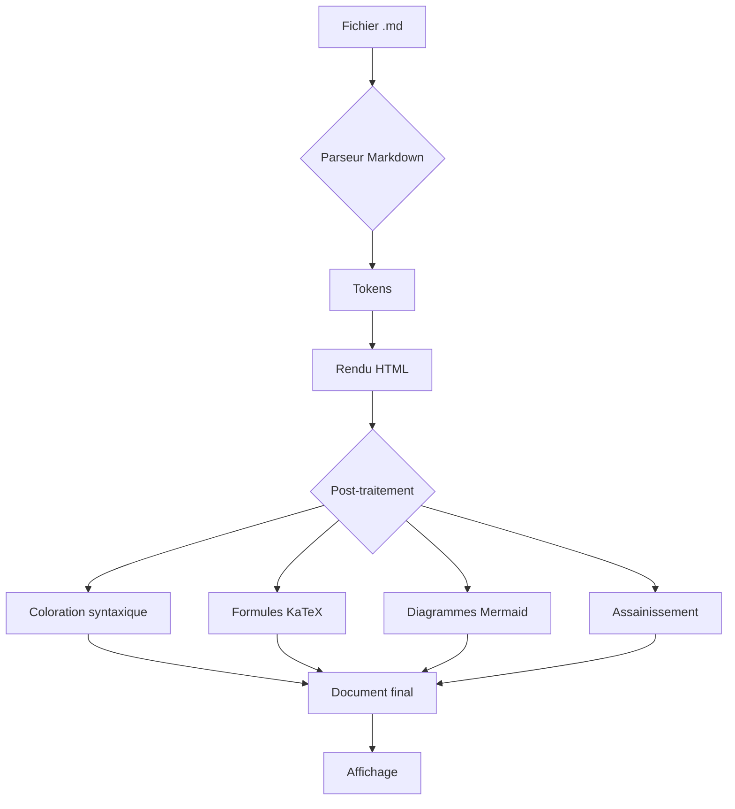
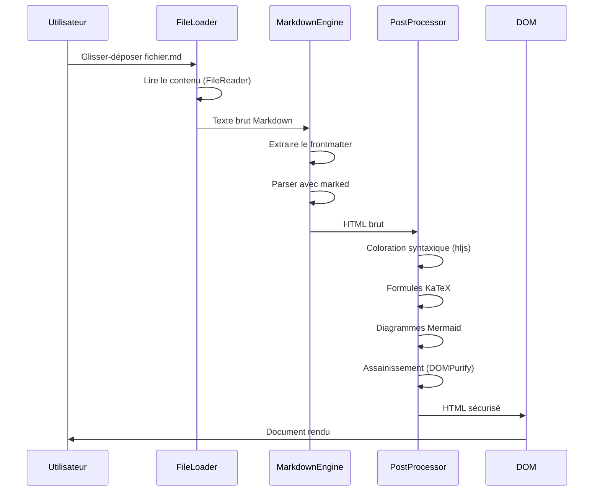
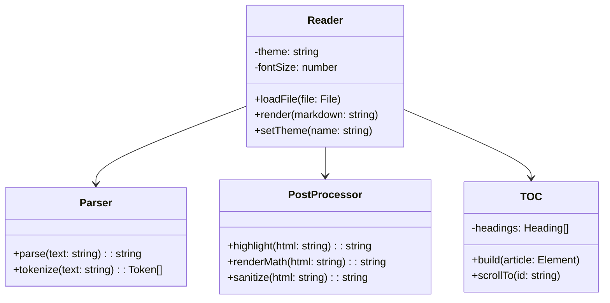
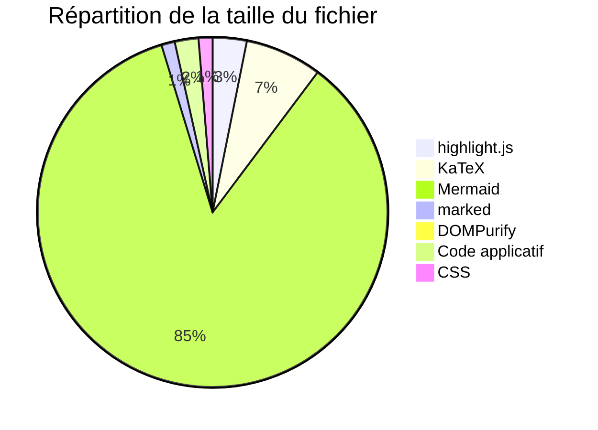

# Document de démonstration complète

Ce document teste l'ensemble des fonctionnalités du Lecteur Markdown Premium. Il couvre les syntaxes CommonMark, GitHub Flavored Markdown et les extensions avancées.

## Table des matières de ce document

- [Typographie de base](#typographie-de-base)
- [Listes et tâches](#listes-et-taches)
- [Citations et alertes](#citations-et-alertes)
- [Code et syntaxe](#code-et-syntaxe)
- [Tableaux](#tableaux)
- [Mathématiques](#mathematiques)
- [Diagrammes](#diagrammes)
- [Images et médias](#images-et-medias)
- [Notes de bas de page](#notes-de-bas-de-page)
- [HTML intégré](#html-integre)
- [Caractères spéciaux](#caracteres-speciaux)
- [Définitions et abréviations](#definitions-et-abreviations)
- [Contenu mixte avancé](#contenu-mixte-avance)
- [Langages supplémentaires](#langages-supplementaires)
- [Section longue pour tester la navigation](#section-longue-pour-tester-la-navigation)

---

## Typographie de base

### Formatage du texte

Voici du texte **en gras**, du texte *en italique*, du texte ***gras et italique***, du texte ~~barré~~, et du `code en ligne`. On peut aussi utiliser des <kbd>raccourcis clavier</kbd> comme <kbd>Ctrl</kbd>+<kbd>C</kbd>.

### Paragraphes longs

La typographie est l'art de rendre un texte lisible, élégant et agréable à parcourir. Elle ne se limite pas au choix d'une police de caractères : elle englobe la hauteur de ligne, la largeur de la colonne de lecture, l'espacement entre les paragraphes, la hiérarchie visuelle des titres, la gestion des césures et des coupures de mots, ainsi que le rythme vertical global de la page. Un lecteur de qualité doit maîtriser tous ces paramètres pour offrir une expérience de lecture confortable pendant plusieurs heures.

Lorem ipsum dolor sit amet, consectetur adipiscing elit. Sed non risus. Suspendisse lectus tortor, dignissim sit amet, adipiscing nec, ultricies sed, dolor. Cras elementum ultrices diam. Maecenas ligula massa, varius a, semper congue, euismod non, mi. Proin porttitor, orci nec nonummy molestie, enim est eleifend mi, non fermentum diam nisl sit amet erat. Duis semper. Duis arcu massa, scelerisque vitae, consequat in, pretium a, enim. Pellentesque congue. Ut in risus volutpat libero pharetra tempor. Cras vestibulum bibendum augue. Praesent egestas leo in pede.

#### Niveaux de titres profonds

##### Titre de niveau 5

###### Titre de niveau 6

Chaque niveau de titre doit être clairement distinguable des autres, avec une taille, un poids et un espacement adaptés.

### Liens

Voici un [lien externe](https://example.com "Exemple de lien") et un [lien interne](#typographie-de-base). Les URLs automatiques fonctionnent aussi : https://example.com

Un [lien de référence][ref1] utilise une syntaxe différente.

[ref1]: https://example.com "Lien de référence"

---

## Listes et tâches

### Listes à puces

- Premier élément
- Deuxième élément avec un texte plus long pour vérifier le retour à la ligne correct dans les listes
- Troisième élément
  - Sous-élément A
  - Sous-élément B
    - Sous-sous-élément I
    - Sous-sous-élément II
  - Sous-élément C
- Quatrième élément

### Listes numérotées

1. Première étape
2. Deuxième étape
3. Troisième étape
   1. Sous-étape 3.1
   2. Sous-étape 3.2
   3. Sous-étape 3.3
4. Quatrième étape

### Liste de tâches

- [x] Implémenter le parseur Markdown
- [x] Ajouter la coloration syntaxique
- [x] Créer le système de thèmes
- [ ] Optimiser les performances pour les très grands documents
- [ ] Ajouter le support de l'impression
  - [x] Feuille de style d'impression de base
  - [ ] Options avancées d'impression

---

## Citations et alertes

### Citations simples

> La typographie est le métier de composer des textes à l'aide de caractères et de règles formelles garantissant que le résultat est lisible, clair et esthétiquement plaisant.

### Citations imbriquées

> Première citation
>
> > Citation imbriquée avec **du texte en gras**
> >
> > > Triple imbrication pour tester la profondeur
>
> Retour au premier niveau

### Alertes GFM

> [!NOTE]
> Ceci est une note informative. Elle contient des informations complémentaires utiles pour le lecteur.

> [!TIP]
> Voici une astuce pratique pour améliorer votre flux de travail.

> [!IMPORTANT]
> Cette information est importante et ne doit pas être ignorée.

> [!WARNING]
> Attention : cette opération est irréversible. Assurez-vous de sauvegarder vos données.

> [!CAUTION]
> Danger potentiel ! Lisez attentivement avant de continuer.

---

## Code et syntaxe

### Code en ligne

Utilisez la fonction `console.log()` pour déboguer. La variable `MAX_SIZE` vaut `1024`. Le fichier de configuration se trouve dans `/etc/config.yml`.

### JavaScript

```javascript
class MarkdownReader {
  constructor(options = {}) {
    this.theme = options.theme || 'light';
    this.fontSize = options.fontSize || 18;
    this.parser = new MarkdownParser({
      gfm: true,
      breaks: false,
      sanitize: true
    });
  }

  async loadFile(file) {
    const text = await file.text();
    const html = this.parser.parse(text);
    document.getElementById('content').innerHTML = html;
    this.highlightCode();
    this.buildTableOfContents();
  }

  highlightCode() {
    document.querySelectorAll('pre code').forEach(block => {
      hljs.highlightElement(block);
    });
  }
}

// Initialisation
const reader = new MarkdownReader({ theme: 'dark' });
document.getElementById('fileInput').addEventListener('change', (e) => {
  reader.loadFile(e.target.files[0]);
});
```

### Python

```python
import hashlib
from pathlib import Path
from typing import Optional

class DocumentProcessor:
    """Traite les fichiers Markdown avec mise en cache."""

    def __init__(self, cache_dir: Optional[Path] = None):
        self.cache_dir = cache_dir or Path.home() / ".cache" / "mdreader"
        self.cache_dir.mkdir(parents=True, exist_ok=True)

    def process(self, filepath: Path) -> str:
        content = filepath.read_text(encoding="utf-8")
        cache_key = hashlib.sha256(content.encode()).hexdigest()

        cached = self.cache_dir / f"{cache_key}.html"
        if cached.exists():
            return cached.read_text()

        html = self._render(content)
        cached.write_text(html)
        return html

    def _render(self, markdown: str) -> str:
        # Pipeline de rendu complet
        tokens = self._tokenize(markdown)
        ast = self._parse(tokens)
        html = self._generate(ast)
        return self._sanitize(html)
```

### SQL

```sql
SELECT
    u.id,
    u.username,
    COUNT(d.id) AS document_count,
    MAX(d.updated_at) AS last_activity,
    COALESCE(SUM(d.word_count), 0) AS total_words
FROM users u
LEFT JOIN documents d ON d.user_id = u.id
WHERE u.created_at >= '2024-01-01'
    AND u.is_active = TRUE
GROUP BY u.id, u.username
HAVING COUNT(d.id) > 5
ORDER BY total_words DESC
LIMIT 20;
```

### CSS

```css
:root {
  --bg-primary: #ffffff;
  --text-primary: #1a1a2e;
  --font-serif: Georgia, 'Times New Roman', serif;
  --content-width: 720px;
}

@media (prefers-color-scheme: dark) {
  :root {
    --bg-primary: #1a1b26;
    --text-primary: #c8cad8;
  }
}

.markdown-body {
  max-width: var(--content-width);
  margin: 0 auto;
  font-family: var(--font-serif);
  line-height: 1.75;
  color: var(--text-primary);
  background: var(--bg-primary);
}
```

### Bash

```bash
#!/bin/bash
set -euo pipefail

REPO_DIR="${1:-.}"
OUTPUT_DIR="./build"

echo "Building Markdown reader from $REPO_DIR..."
mkdir -p "$OUTPUT_DIR"

# Concatenate all source files
cat "$REPO_DIR/src/header.html" > "$OUTPUT_DIR/index.html"

for lib in marked purify highlight katex mermaid; do
    echo "<script>" >> "$OUTPUT_DIR/index.html"
    cat "$REPO_DIR/vendor/$lib.min.js" >> "$OUTPUT_DIR/index.html"
    echo "</script>" >> "$OUTPUT_DIR/index.html"
done

echo "Build complete: $(du -h "$OUTPUT_DIR/index.html" | cut -f1)"
```

### JSON

```json
{
  "name": "markdown-reader",
  "version": "1.0.0",
  "description": "Lecteur Markdown autonome",
  "dependencies": {
    "marked": "^12.0.0",
    "dompurify": "^3.1.0",
    "katex": "^0.16.0"
  },
  "config": {
    "themes": ["light", "dark", "sepia", "contrast"],
    "defaultFontSize": 18,
    "maxFileSize": 10485760
  }
}
```

### Bloc de code indenté

    Ceci est un bloc de code indenté
    Il utilise 4 espaces d'indentation
    plutôt que des délimiteurs ```

### Code avec lignes très longues

```text
Cette ligne est volontairement très longue pour tester le comportement du défilement horizontal dans les blocs de code. Elle doit pouvoir être lue intégralement sans casser la mise en page générale du document, que ce soit sur un écran large ou sur un appareil mobile.
```

---

## Tableaux

### Tableau simple

| Fonctionnalité | Statut | Priorité |
|---|---|---|
| Rendu Markdown | Complet | Haute |
| Thèmes | Complet | Haute |
| Recherche | Complet | Moyenne |
| Impression | Partiel | Basse |

### Tableau avec alignement

| Propriété | Valeur par défaut | Min | Max | Description |
|:---|:---:|---:|---:|:---|
| fontSize | 18px | 14px | 24px | Taille du texte principal |
| lineHeight | 1.75 | 1.4 | 2.2 | Hauteur de ligne relative |
| contentWidth | 720px | 500px | 1000px | Largeur maximale du contenu |
| letterSpacing | 0 | -0.05em | 0.1em | Espacement des caractères |

### Tableau complexe

| Bibliothèque | Version | Taille | Licence | Usage |
|---|---|---|---|---|
| marked | 12.0.2 | ~48 Ko | MIT | Parseur Markdown CommonMark + GFM |
| DOMPurify | 3.1.6 | ~18 Ko | Apache 2.0 | Assainissement HTML contre les XSS |
| highlight.js | 11.9.0 | ~122 Ko | BSD 3-Clause | Coloration syntaxique de code |
| KaTeX | 0.16.10 | ~275 Ko | MIT | Rendu de formules mathématiques LaTeX |
| Mermaid | 10.9.1 | ~3,3 Mo | MIT | Rendu de diagrammes |

---

## Mathématiques

### Formules en ligne

La célèbre équation d'Einstein $E = mc^2$ relie l'énergie à la masse. L'identité d'Euler $e^{i\pi} + 1 = 0$ est considérée comme l'une des plus belles formules mathématiques.

La distribution normale est définie par $f(x) = \frac{1}{\sigma\sqrt{2\pi}} e^{-\frac{(x-\mu)^2}{2\sigma^2}}$.

### Formules en bloc

L'intégrale de Gauss :

$$\int_{-\infty}^{\infty} e^{-x^2} \, dx = \sqrt{\pi}$$

La série de Taylor :

$$f(x) = \sum_{n=0}^{\infty} \frac{f^{(n)}(a)}{n!}(x-a)^n$$

Le théorème de Bayes :

$$P(A|B) = \frac{P(B|A) \cdot P(A)}{P(B)}$$

Formule de la transformée de Fourier :

$$\hat{f}(\xi) = \int_{-\infty}^{\infty} f(x) \, e^{-2\pi i x \xi} \, dx$$

Matrices :

$$A = \begin{pmatrix} a_{11} & a_{12} & \cdots & a_{1n} \\ a_{21} & a_{22} & \cdots & a_{2n} \\ \vdots & \vdots & \ddots & \vdots \\ a_{m1} & a_{m2} & \cdots & a_{mn} \end{pmatrix}$$

---

## Diagrammes

### Diagramme Mermaid



### Diagramme de séquence



### Diagramme de classes



### Diagramme circulaire



---

## Images et médias

### Image avec texte alternatif


### Image redimensionnée


### Image locale


---

## Notes de bas de page

Le Markdown[^1] a été créé par John Gruber en 2004. Le format a depuis évolué avec de nombreuses extensions[^2], dont la plus notable est GitHub Flavored Markdown[^gfm].

Le rendu des notes de bas de page[^4] nécessite un traitement spécifique car elles ne font pas partie de la spécification CommonMark de base.

[^1]: Markdown est un langage de balisage léger conçu pour être facile à lire et à écrire.
[^2]: Parmi les extensions populaires : tables, listes de tâches, coloration syntaxique, formules mathématiques.
[^gfm]: GitHub Flavored Markdown (GFM) est la variante de Markdown utilisée par GitHub, ajoutant le support des tables, des listes de tâches et des mentions.
[^4]: Les notes de bas de page utilisent la syntaxe `[^id]` pour les références et `[^id]: contenu` pour les définitions.

---

## HTML intégré

<details>
<summary>Cliquez pour développer cette section</summary>

Ce contenu est masqué par défaut grâce à l'élément HTML `<details>`. Il permet de réduire la longueur visible du document tout en conservant l'information accessible.

- Point 1
- Point 2
- Point 3

</details>

<div style="padding: 12px; border: 1px solid #ccc; border-radius: 6px; margin: 1em 0;">
  <strong>Encadré HTML personnalisé</strong>
  <p>Ce paragraphe utilise du HTML intégré au Markdown avec des styles en ligne.</p>
</div>

<mark>Texte surligné avec la balise mark</mark>

Texte avec <sup>exposant</sup> et <sub>indice</sub>.

Abréviation : <abbr title="Hypertext Markup Language">HTML</abbr>

---

## Caractères spéciaux

### Caractères Unicode

Flèches : → ← ↑ ↓ ↔ ⇒ ⇐ ⇑ ⇓

Symboles mathématiques : ∞ ∑ ∏ √ ∫ ≈ ≠ ≤ ≥ ± ÷ × ∈ ∉ ⊂ ⊃

Caractères accentués français : à â ä é è ê ë ï î ô ö ù û ü ÿ ç œ æ

Cyrillique : Привет мир

Japonais : こんにちは世界

Arabe : مرحبا بالعالم

Emojis : 🎉 📚 ✅ ⚠️ 💡 🔍 ⚙️ 🎨

### Échappement Markdown

\*Ce texte n'est pas en italique\*

\`Ce texte n'est pas du code\`

\[Ce n'est pas un lien\](pas-un-url)

### Séparateurs

---

***

___

## Syntaxes mal formées (test de résilience)

### Tableau mal formé

| Colonne 1 | Colonne 2
|---|
| donnée | manquante |
| extra | données | surplus |

### Code non fermé

```
Ce bloc de code n'a pas de balise fermante explicite avec un langage spécifié
mais devrait quand même s'afficher correctement.
```

### Lien mal formé

[Texte sans URL]()

[](https://example.com)

### Formule mal formée

$\frac{x}{$

### Image sans source


---

## Définitions et abréviations

Terme simple
: Une définition sur une seule ligne.

Markdown
: Langage de balisage léger créé par John Gruber en 2004.
: Permet d'écrire du contenu formaté avec une syntaxe lisible en texte brut.

CommonMark
: Spécification standardisée du langage Markdown, visant à éliminer les ambiguïtés de la syntaxe originale.

GFM (GitHub Flavored Markdown)
: Extension de CommonMark utilisée par GitHub, ajoutant le support des tableaux, listes de tâches, barré et autolinks.

---

## Contenu mixte avancé

### Liste avec du code et des formules

1. La complexité temporelle du tri rapide est en moyenne $O(n \log n)$, ce qui le rend efficace pour la plupart des cas :
   ```python
   def quicksort(arr):
       if len(arr) <= 1:
           return arr
       pivot = arr[len(arr) // 2]
       left = [x for x in arr if x < pivot]
       middle = [x for x in arr if x == pivot]
       right = [x for x in arr if x > pivot]
       return quicksort(left) + middle + quicksort(right)
   ```

2. La formule de Stirling approxime la factorielle pour les grands nombres :
   $$n! \approx \sqrt{2\pi n} \left(\frac{n}{e}\right)^n$$

3. En TypeScript, les types génériques permettent la réutilisabilité :
   ```typescript
   interface Repository<T extends { id: string }> {
     findById(id: string): Promise<T | null>;
     save(entity: T): Promise<void>;
     delete(id: string): Promise<boolean>;
   }

   class InMemoryRepo<T extends { id: string }> implements Repository<T> {
     private store = new Map<string, T>();

     async findById(id: string) {
       return this.store.get(id) ?? null;
     }
     async save(entity: T) {
       this.store.set(entity.id, entity);
     }
     async delete(id: string) {
       return this.store.delete(id);
     }
   }
   ```

### Citation avec du code

> Pour vérifier si un nombre est premier en $O(\sqrt{n})$ :
>
> ```python
> def is_prime(n: int) -> bool:
>     if n < 2:
>         return False
>     for i in range(2, int(n**0.5) + 1):
>         if n % i == 0:
>             return False
>     return True
> ```
>
> — *Algorithmes fondamentaux*, chapitre 3

### Tableau avec formules

| Loi | Formule | Domaine |
|:---|:---:|:---|
| Newton (gravitation) | $F = G\frac{m_1 m_2}{r^2}$ | Mécanique classique |
| Coulomb | $F = k_e\frac{q_1 q_2}{r^2}$ | Électrostatique |
| Boltzmann | $S = k_B \ln \Omega$ | Thermodynamique |
| Schrödinger | $i\hbar\frac{\partial}{\partial t}\Psi = \hat{H}\Psi$ | Mécanique quantique |
| Maxwell-Faraday | $\nabla \times \mathbf{E} = -\frac{\partial \mathbf{B}}{\partial t}$ | Électromagnétisme |

---

## Langages supplémentaires

### Rust

```rust
use std::collections::HashMap;

#[derive(Debug, Clone)]
struct Document {
    title: String,
    content: String,
    word_count: usize,
    metadata: HashMap<String, String>,
}

impl Document {
    fn new(title: &str, content: &str) -> Self {
        let word_count = content.split_whitespace().count();
        Self {
            title: title.to_string(),
            content: content.to_string(),
            word_count,
            metadata: HashMap::new(),
        }
    }

    fn reading_time(&self, wpm: usize) -> std::time::Duration {
        let minutes = self.word_count / wpm;
        std::time::Duration::from_secs((minutes * 60) as u64)
    }
}

fn main() {
    let mut doc = Document::new("Démo", "Ceci est un document de test.");
    doc.metadata.insert("author".into(), "Équipe".into());
    println!("{:#?}", doc);
    println!("Temps de lecture : {:?}", doc.reading_time(250));
}
```

### Go

```go
package main

import (
	"crypto/sha256"
	"fmt"
	"io"
	"os"
	"strings"
)

type FileInfo struct {
	Name     string
	Size     int64
	Hash     string
	Words    int
}

func analyzeFile(path string) (*FileInfo, error) {
	f, err := os.Open(path)
	if err != nil {
		return nil, fmt.Errorf("cannot open %s: %w", path, err)
	}
	defer f.Close()

	h := sha256.New()
	content, err := io.ReadAll(io.TeeReader(f, h))
	if err != nil {
		return nil, err
	}

	stat, _ := f.Stat()
	return &FileInfo{
		Name:  stat.Name(),
		Size:  stat.Size(),
		Hash:  fmt.Sprintf("%x", h.Sum(nil)),
		Words: len(strings.Fields(string(content))),
	}, nil
}

func main() {
	info, err := analyzeFile("demo.md")
	if err != nil {
		fmt.Fprintf(os.Stderr, "Error: %v\n", err)
		os.Exit(1)
	}
	fmt.Printf("File: %s (%d bytes, %d words)\nSHA256: %s\n",
		info.Name, info.Size, info.Words, info.Hash)
}
```

### HTML

```html
<!DOCTYPE html>
<html lang="fr">
<head>
  <meta charset="UTF-8">
  <meta name="viewport" content="width=device-width, initial-scale=1.0">
  <title>Lecteur Markdown</title>
  <style>
    :root {
      --bg: #fff;
      --fg: #1a1a2e;
    }
    body {
      font-family: Georgia, serif;
      max-width: 720px;
      margin: 2rem auto;
      color: var(--fg);
      background: var(--bg);
    }
  </style>
</head>
<body>
  <main id="content" role="main">
    <article class="markdown-body"></article>
  </main>
  <script type="module" src="./reader.js"></script>
</body>
</html>
```

### YAML

```yaml
app:
  name: Lecteur Markdown Premium
  version: 1.0.0
  description: >
    Lecteur Markdown autonome, élégant et performant,
    fonctionnant entièrement côté client.

features:
  rendering:
    - CommonMark compliant
    - GitHub Flavored Markdown
    - KaTeX math formulas
    - Mermaid diagrams
    - Syntax highlighting (190+ languages)
  ui:
    themes: [light, dark, sepia, contrast]
    font_sizes: { min: 14, max: 24, default: 18 }
    sidebar: true
    minimap: true
    focus_mode: true
  storage:
    type: IndexedDB + localStorage
    persistence:
      - file_handles
      - bookmarks
      - annotations
      - reading_positions
      - preferences
```

### Diff

```diff
--- a/src/reader.ts
+++ b/src/reader.ts
@@ -42,7 +42,9 @@ class MarkdownEngine {
   init() {
     marked.setOptions({
       gfm: true,
-      breaks: false
+      breaks: false,
+      pedantic: false,
+      mangle: false
     });
   }

-  render(text: string): string {
+  async render(text: string): Promise<string> {
     const frontmatter = this.extractFrontmatter(text);
-    return marked.parse(text);
+    const html = await marked.parse(text);
+    return DOMPurify.sanitize(html);
   }
```

---

## Section longue pour tester la navigation

### Sous-section 1 — Architecture du lecteur

Le lecteur Markdown Premium repose sur une architecture modulaire où chaque composant gère un aspect spécifique de l'application. Le module `FileLoader` gère l'entrée des fichiers via le glisser-déposer, le sélecteur de fichiers natif et l'API File System Access pour la persistance des handles. Le `MarkdownEngine` configure marked avec les options GFM et gère l'extraction du frontmatter YAML.

Le `PostProcessor` est le cœur du pipeline de rendu : il prend le HTML brut produit par marked et lui applique successivement la coloration syntaxique via highlight.js, le rendu des formules mathématiques via KaTeX, le rendu des diagrammes via Mermaid, les alertes GFM stylisées, la typographie française automatique (espaces insécables avant les ponctuations doubles), et enfin l'assainissement via DOMPurify pour prévenir toute injection XSS.

### Sous-section 2 — Gestion des thèmes

Le système de thèmes utilise des variables CSS personnalisées définies sur `:root`. Quatre thèmes sont disponibles : **Clair** (fond blanc, texte sombre), **Sombre** (fond bleu-nuit, texte clair), **Sépia** (fond beige chaud, texte brun) et **Contraste** (fond noir pur, texte blanc pur, conçu pour l'accessibilité). Le changement de thème est instantané grâce à la modification d'un unique attribut `data-theme` sur l'élément racine.

Les préférences de thème sont persistées dans le `localStorage` et restaurées automatiquement au chargement. Le thème par défaut respecte la préférence système via `prefers-color-scheme`. Les blocs de code adaptent également leur coloration au thème actif pour maintenir une cohérence visuelle.

### Sous-section 3 — Système de signets et annotations

Les signets permettent de marquer des positions spécifiques dans un document. Chaque signet est associé à un hash du fichier, au texte du titre le plus proche, et à la position de défilement. Les signets sont stockés dans le `localStorage` et affichés dans le panneau latéral sous la table des matières.

Les annotations vont plus loin : l'utilisateur sélectionne du texte, ajoute un commentaire, et l'annotation est ancrée au contenu via un identifiant de position. Les annotations sont surlignées dans le document et peuvent être éditées ou supprimées depuis le panneau dédié. La persistance se fait également via le `localStorage`, indexée par le hash du fichier.

### Sous-section 4 — Performances et optimisations

Pour les documents volumineux (>100 000 mots), plusieurs optimisations sont en place :

- **Debounce et throttle** sur les événements fréquents (scroll, resize, input) pour limiter les recalculs
- **IntersectionObserver** pour le suivi de la section active dans la table des matières, évitant un recalcul coûteux à chaque événement scroll
- **Rendu différé** des diagrammes Mermaid qui sont processés de manière asynchrone
- **Minimap** qui utilise un canvas redimensionné pour visualiser la structure du document sans recréer le DOM
- **Cache de position** pour restaurer instantanément la dernière position de lecture d'un fichier déjà ouvert

Le lecteur reste réactif même avec des documents dépassant 500 Ko de Markdown brut, grâce à ces optimisations appliquées à chaque étape du pipeline.

### Sous-section 5 — Accessibilité

L'accessibilité est une priorité du lecteur :

- Tous les boutons ont des attributs `aria-label` descriptifs
- La navigation au clavier est complète : <kbd>T</kbd> pour la table des matières, <kbd>S</kbd> pour les réglages, <kbd>F</kbd> pour le mode focus, <kbd>?</kbd> pour l'aide
- Un module `Announcer` utilise une zone `aria-live` pour signaler les actions aux lecteurs d'écran (changement de thème, ouverture de panneau, résultats de recherche)
- Les contrastes de couleurs respectent les recommandations WCAG AA dans tous les thèmes
- Le thème « Contraste » offre un mode WCAG AAA pour les utilisateurs avec des déficiences visuelles sévères
- Le mode focus réduit les distractions en masquant tout sauf le paragraphe en cours de lecture

---

*Fin du document de démonstration. Ce fichier couvre l'ensemble des fonctionnalités du Lecteur Markdown Premium : titres imbriqués, listes (à puces, numérotées, tâches), citations et alertes GFM, blocs de code dans 10 langages (JavaScript, Python, SQL, CSS, Bash, JSON, Rust, Go, HTML, YAML, diff), tableaux simples et complexes, formules mathématiques en ligne et en bloc, diagrammes Mermaid (flux, séquence, classes, circulaire), images, notes de bas de page, HTML intégré, caractères Unicode, définitions, contenu mixte avancé et syntaxes mal formées.*
